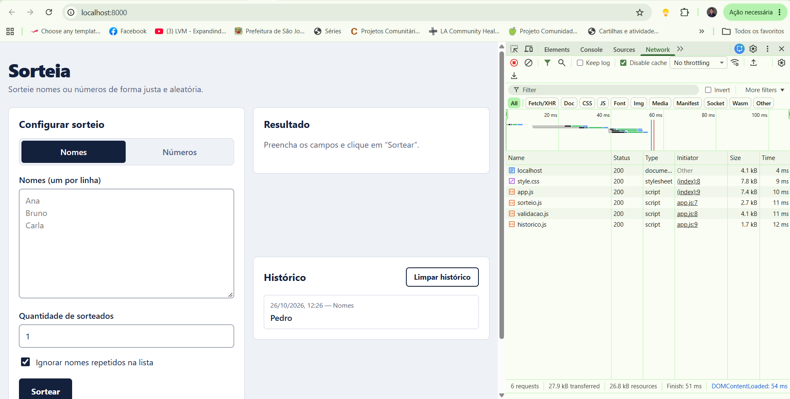

# 🎰 Sorteia

Sorteador web de **nomes** e **números**: aleatório, sem cadastro e sem anúncios.

## O que o app faz

- Sorteia **nomes** de uma lista (um por linha), escolhendo quantos serão sorteados.
- Sorteia **números inteiros** em um intervalo (ex.: 1 a 60), com ou sem repetição.
- Ignora linhas vazias e, se desejado, nomes repetidos.
- Mostra o resultado como "bilhetes" numerados pela ordem do sorteio e permite **copiar** o resultado.
- Guarda os **10 últimos sorteios** no navegador (`localStorage`), sem enviar nada a servidor algum.
- Funciona com entrada vazia ou inválida: mostra uma mensagem explicando o que corrigir.

**O que não faz:** login/cadastro, sincronização do histórico entre aparelhos e sorteios com pesos diferentes.

## Exemplo de uso

1. Na aba **Nomes**, digite `Ana`, `Bruno`, `Carla`, `Diego` e `Elisa` (um por linha).
2. Em "Quantidade de sorteados", digite `2` e clique em **Sortear**.
3. Aparece, por exemplo, `1 Carla` e `2 Ana`, com a mensagem "2 sorteados entre 5 nomes."

## Como rodar

O app é HTML, CSS e JavaScript puros (módulos ES), sem frameworks. Como usa módulos, precisa ser aberto por um servidor local (não funciona com duplo clique no arquivo):

- **VS Code:** instale a extensão *Live Server* e clique em *Go Live*; ou
- **Terminal**, na pasta do projeto:

```bash
python -m http.server 8000
```

Depois abra <http://localhost:8000>.

### Testes (opcional)

Com Node 20 ou superior:

```bash
npm test
```

## Estrutura

```
index.html          página (HTML semântico)
css/style.css       estilos (responsivo, tema claro/escuro)
js/sorteio.js       lógica do sorteio (crypto.getRandomValues + Fisher-Yates)
js/validacao.js     validação e limites das entradas
js/historico.js     histórico no localStorage
js/app.js           interface: lê campos, chama a lógica e atualiza a página
tests/              testes unitários (node --test)
```

## Decisões técnicas e segurança

- **Trilha C (sem API):** a lógica fica no código e os dados no `localStorage`. Não há chaves de API no repositório nem no histórico de commits.
- **`textContent`, nunca `innerHTML`:** nomes digitados e dados lidos do `localStorage` entram na página com `textContent`, então HTML ou scripts digitados aparecem como texto e não são executados.
- **Aleatoriedade justa:** usa `crypto.getRandomValues` (em vez de `Math.random`), com descarte de valores para evitar viés, e embaralhamento Fisher-Yates.
- **Limites:** até 10.000 nomes (100 caracteres cada), até 1.000 sorteados por vez e números entre -1.000.000.000 e 1.000.000.000, para não travar o navegador.
- **Acessibilidade:** `label` ligado a cada campo, `aria-live` no resultado, `aria-invalid` nos erros, foco visível, link para pular ao conteúdo e animação desligada para quem prefere menos movimento.
- **Plano B:** como o app não usa API, não há dependência de internet depois que a página carrega.

## Aba Rede do navegador



[Explicação, 2 a 3 linhas: o print mostra a requisição `GET http://localhost:8000/` (o `index.html`) com status `200 OK`, seguida dos arquivos `css/style.css` e `js/*.js`, também com `GET` e `200`. Como o app é da trilha C, não há chamadas a APIs externas: tudo é carregado do servidor local e os dados ficam só no navegador.]

## Uso de IA

| Item | Detalhe |
| --- | --- |
| Claude (Anthropic) | Usado para ajudar a elaborar esta proposta, sugerir a estrutura do projeto e gerar um rascunho do código. |
| Gemini (Google) | Usado para revisar código. |

## Commits

O histórico segue o padrão [Conventional Commits](https://www.conventionalcommits.org/pt-br/) (`feat`, `fix`, `style`, `docs`, `test`, `chore`).

## 👥 Créditos

**Aluno:** José Nunes de Sousa Neto - 20250071231

**Disciplina:** EECP0036 - Desenvolvimento de Sistemas WEB

**Professor:** Prof. Renan Sousa Freire

**Instituição:** UFMA — Universidade Federal do Maranhão

**Semestre:** 2026.2

---

<div align="center">

**Este repositório possui fins acadêmicos.**

</div>

---
